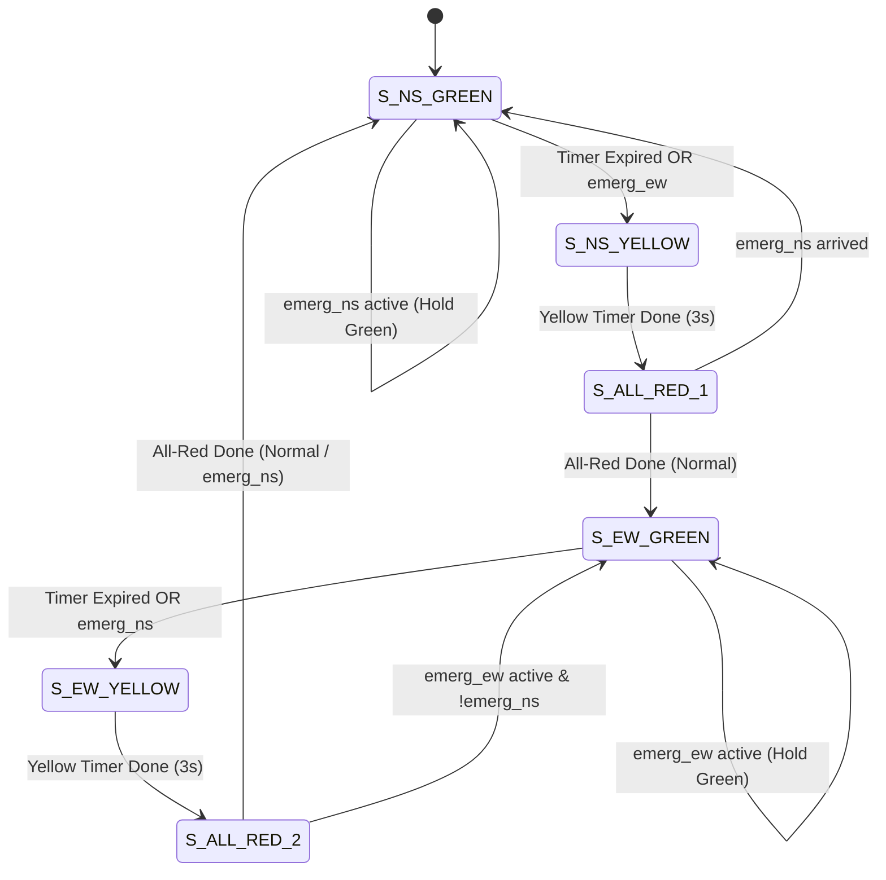

# FSM-Based Priority Traffic Light Controller with Emergency Vehicle Detection

[](traffic_light_controller.v)
[](tb_traffic_light_controller.v)
[](basys3_master.xdc)
[](Traffic_Light_Controller_Documentation.pdf)
[](LICENSE)

A fully synthesizable **Moore Finite State Machine (FSM)** traffic light controller implemented in Verilog-2001 for a 4-way intersection (North-South vs. East-West). Designed with deterministic anti-collision guarantees, pedestrian/vehicular clearance buffers, and dynamic **two-tier preemption for emergency vehicles** (ambulances, fire engines, police units).

> 📄 **Complete Technical Report**: A detailed 5-page specification, state transition analysis, RTL walkthrough, and waveform breakdown is available in [`Traffic_Light_Controller_Documentation.pdf`](Traffic_Light_Controller_Documentation.pdf).

---

## 📸 Simulation Waveform Result

Below is the verified behavioral simulation running in **AMD Xilinx Vivado (XSim)**, demonstrating normal cycling, emergency preemption, and safe yellow transition braking:


---

## 🚦 Key Engineering Features

1. **Deterministic Safety Transitions**:
   * Under **no** circumstance does an active Green light snap directly to Red upon emergency detection.
   * Traffic is always transitioned through a mandatory **Yellow** braking period (3s) and an **All-Red clearance buffer** (1s) before yielding passage, preventing high-speed broadside collisions.
2. **Two-Tier Priority Preemption**:
   * **Tier 1 (Highest)**: North-South Emergency (`emerg_ns`) — Main Arterial Street.
   * **Tier 2 (Secondary)**: East-West Emergency (`emerg_ew`) — Side Street.
   * **Tie-Breaker**: If both emergency sensors trigger simultaneously, NS is granted priority first; EW is automatically serviced next as soon as NS clears.
3. **Parameterizable Hardware**:
   * Timing intervals (`SEC_NS_GREEN`, `SEC_EW_GREEN`, `SEC_YELLOW`, `SEC_ALL_RED`) and clock prescaler (`CLK_FREQ_HZ`) are fully configurable via module parameters.
   * Fast simulation scaling (`CLK_FREQ_HZ = 4`) enables full multi-scenario verification in **under 2 µs**.
4. **Glitch-Free Registered Outputs**:
   * Light outputs are updated synchronously on clock edges to eliminate combinational hazards on physical FPGA I/O pins and LEDs.

---

## 🔄 FSM State Transition Diagram



---

## 📊 State Encoding & Light Outputs

| State Code (`state_out`) | State Name | NS Light (`ns_lights[2:0]`) | EW Light (`ew_lights[2:0]`) | Default Duration | Description |
| :---: | :---: | :---: | :---: | :---: | :--- |
| `3'b000` | `S_NS_GREEN` | **GREEN** (`3'b001`) | **RED** (`3'b100`) | 10 s | North-South main traffic flow |
| `3'b001` | `S_NS_YELLOW` | **YELLOW** (`3'b010`) | **RED** (`3'b100`) | 3 s | North-South braking transition |
| `3'b010` | `S_ALL_RED_1` | **RED** (`3'b100`) | **RED** (`3'b100`) | 1 s | Interlock safety clearance |
| `3'b011` | `S_EW_GREEN` | **RED** (`3'b100`) | **GREEN** (`3'b001`) | 7 s | East-West side street traffic flow |
| `3'b100` | `S_EW_YELLOW` | **RED** (`3'b100`) | **YELLOW** (`3'b010`) | 3 s | East-West braking transition |
| `3'b101` | `S_ALL_RED_2` | **RED** (`3'b100`) | **RED** (`3'b100`) | 1 s | Interlock safety clearance |

*Light encoding bus: `[2] = Red`, `[1] = Yellow`, `[0] = Green`.*

---

## 🔌 Top-Level I/O Port Description

| Port Name | Direction | Width | Default Pin (Basys 3) | Description |
| :--- | :---: | :---: | :---: | :--- |
| `clk` | Input | 1 bit | `W5` | 100 MHz Master Oscillator Clock |
| `rst_n` | Input | 1 bit | `V17` (SW0) | Active-Low Asynchronous Master Reset |
| `emerg_ns` | Input | 1 bit | `U18` (BTNC) | North-South Emergency Vehicle Sensor (Active-High) |
| `emerg_ew` | Input | 1 bit | `T18` (BTNU) | East-West Emergency Vehicle Sensor (Active-High) |
| `ns_green` | Output | 1 bit | `U16` (LD0) | North-South Green Light LED |
| `ns_yellow` | Output | 1 bit | `E19` (LD1) | North-South Yellow Light LED |
| `ns_red` | Output | 1 bit | `U19` (LD2) | North-South Red Light LED |
| `ew_green` | Output | 1 bit | `V19` (LD3) | East-West Green Light LED |
| `ew_yellow` | Output | 1 bit | `W18` (LD4) | East-West Yellow Light LED |
| `ew_red` | Output | 1 bit | `U15` (LD5) | East-West Red Light LED |
| `state_out[2:0]` | Output | 3 bits | `L1, P1, N3` | Encoded current state index for debug / 7-segment |

---

## 🧪 Verification & Testbench Scenarios

The self-checking testbench ([`tb_traffic_light_controller.v`](tb_traffic_light_controller.v)) covers four critical verification stages:

1. **Test Case 1: Normal Uninterrupted Cycle**
   * Verifies cyclic rotation through all 6 states according to programmed timing parameters.
2. **Test Case 2: NS Emergency while EW is Green**
   * Confirms EW does not snap to Red; safely steps through `EW_YELLOW` $\rightarrow$ `ALL_RED_2` $\rightarrow$ `NS_GREEN`.
   * Verifies extended Green hold while `emerg_ns` remains asserted.
3. **Test Case 3: EW Emergency while NS is Green**
   * Confirms safe transition through `NS_YELLOW` $\rightarrow$ `ALL_RED_1` $\rightarrow$ `EW_GREEN`.
4. **Test Case 4: Simultaneous Conflict Resolution**
   * Asserts both `emerg_ns = 1` and `emerg_ew = 1`. Confirms NS is serviced first, followed by EW upon clearance.
5. **Continuous Hardware Assertions**:
   * Active monitors assert that `ns_green` and `ew_green` can **never** be asserted simultaneously.

---

## ⚡ FPGA Resource Utilization (Artix-7 XC7A35T)

| Resource | Estimated Usage | Total Available | Utilization % |
| :--- | :---: | :---: | :---: |
| **Slice LUTs** | ~65 | 20,800 | < 0.4 % |
| **Slice Registers (FFs)** | 44 | 41,600 | < 0.2 % |
| **Global Clock Buffers (BUFG)** | 1 | 32 | 3.1 % |
| **DSP48 / Block RAM** | 0 | 90 / 50 | 0.0 % |

---

## 📁 Repository Structure

```text
├── traffic_light_controller.v            # Synthesizable RTL Module
├── tb_traffic_light_controller.v         # Self-checking Testbench
├── basys3_master.xdc                     # Digilent Basys 3 FPGA Pin Constraints
├── simulation_waveform.png               # Vivado Simulation Waveform Screenshot
├── Traffic_Light_Controller_Documentation.pdf # Comprehensive 5-Page Technical PDF Report
├── generate_pdf_doc.py                   # ReportLab PDF Generation Script
├── .gitignore                            # Vivado artifacts ignore filter
├── README.md                             # Project Documentation
└── LICENSE                               # MIT License
```

---

## 🚀 How to Run in Xilinx Vivado

1. **Create Project**:
   * Open Vivado $\rightarrow$ **Create Project** $\rightarrow$ Name it `Traffic_Light_Controller` $\rightarrow$ Select **RTL Project**.
   * Choose target part (e.g. Basys 3: `xc7a35tcpg236-1`).
2. **Add Sources**:
   * Add [`traffic_light_controller.v`](traffic_light_controller.v) as **Design Source**.
   * Add [`tb_traffic_light_controller.v`](tb_traffic_light_controller.v) as **Simulation Source**.
   * Add [`basys3_master.xdc`](basys3_master.xdc) as **Constraints**.
3. **Run Simulation**:
   * Under **Flow Navigator**, click **Run Simulation** $\rightarrow$ **Run Behavioral Simulation**.
4. **Inspect Waveform**:
   * Click **Zoom Fit** (`F`) to view the entire timeline.
   * Right-click `state_name`, `ns_light_str`, and `ew_light_str` $\rightarrow$ **Radix** $\rightarrow$ **ASCII** to view live state transitions.

---

## 📜 License

This project is licensed under the MIT License - see the [LICENSE](LICENSE) file for details.
