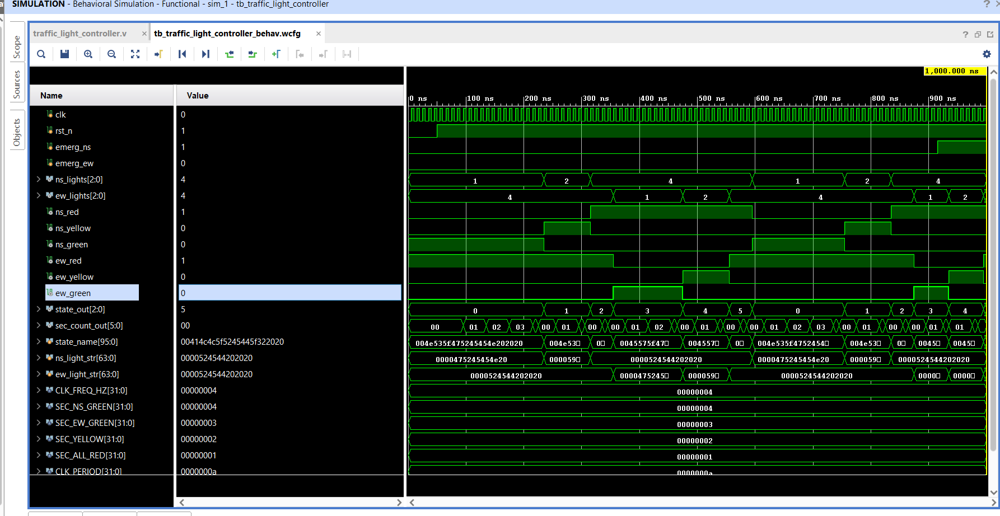
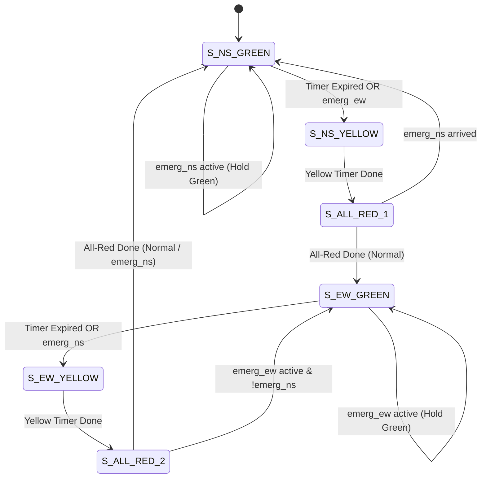

# FSM-Based Priority Traffic Light Controller with Emergency Vehicle Detection


A fully synthesizable **Finite State Machine (FSM)** traffic light controller implemented in Verilog-2001 for a 4-way intersection (North-South vs. East-West). Designed with deterministic safety transitions, pedestrian/vehicle clearance buffers, and dynamic **preemption for emergency vehicles** (ambulances, fire engines, police).

---

## 📸 Simulation Waveform Result

Below is the verified behavioral simulation running in **Vivado XSim**, demonstrating normal cycling, emergency preemption, and safe yellow transition braking:



---

## 🚦 Key Engineering Features

1. **Deterministic Safety Transitions**:
   * Under **no** circumstance does an active Green light snap directly to Red upon emergency detection.
   * Traffic is always transitioned through a mandatory **Yellow** braking period and an **All-Red clearance buffer** before yielding passage, preventing intersection collisions.
2. **Priority Preemption Scheme**:
   * **Tier 1 (Highest)**: North-South Emergency (`emerg_ns`) — Main Street.
   * **Tier 2 (Secondary)**: East-West Emergency (`emerg_ew`) — Side Street.
   * **Tie-Breaker**: If both emergency sensors trigger simultaneously, NS is granted priority first; EW is automatically serviced next as soon as NS clears.
3. **Parameterizable Architecture**:
   * Timing intervals (`SEC_NS_GREEN`, `SEC_EW_GREEN`, `SEC_YELLOW`, `SEC_ALL_RED`) and clock prescaler (`CLK_FREQ_HZ`) are fully configurable via module parameters.
   * Fast simulation parameter scaling enables full multi-scenario verification in **under 2 µs**.
4. **Glitch-Free Registered Outputs**:
   * Light outputs are updated synchronously to eliminate logic glitches on physical FPGA LEDs.

---

## 🔄 FSM State Transition Diagram



---

## 📊 State Encoding & Light Outputs

| State Code (`state_out`) | State Name | NS Light (`ns_lights[2:0]`) | EW Light (`ew_lights[2:0]`) | Description |
| :---: | :---: | :---: | :---: | :--- |
| `3'b000` | `S_NS_GREEN` | **GREEN** (`3'b001`) | **RED** (`3'b100`) | North-South main traffic flow |
| `3'b001` | `S_NS_YELLOW` | **YELLOW** (`3'b010`) | **RED** (`3'b100`) | North-South braking transition |
| `3'b010` | `S_ALL_RED_1` | **RED** (`3'b100`) | **RED** (`3'b100`) | Interlock safety clearance |
| `3'b011` | `S_EW_GREEN` | **RED** (`3'b100`) | **GREEN** (`3'b001`) | East-West side street traffic flow |
| `3'b100` | `S_EW_YELLOW` | **RED** (`3'b100`) | **YELLOW** (`3'b010`) | East-West braking transition |
| `3'b101` | `S_ALL_RED_2` | **RED** (`3'b100`) | **RED** (`3'b100`) | Interlock safety clearance |

*Light encoding bus: `[2] = Red`, `[1] = Yellow`, `[0] = Green`.*

---

## 🧪 Verification & Testbench Scenarios

The testbench ([`tb_traffic_light_controller.v`](tb_traffic_light_controller.v)) covers four critical verification stages:

1. **Test Case 1: Normal Uninterrupted Cycle**
   * Verifies cyclic rotation through all 6 states according to programmed timing parameters.
2. **Test Case 2: NS Emergency while EW is Green**
   * Confirms EW does not snap to Red; safely steps through `EW_YELLOW` $\rightarrow$ `ALL_RED_2` $\rightarrow$ `NS_GREEN`.
   * Verifies extended Green hold while `emerg_ns` remains asserted.
3. **Test Case 3: EW Emergency while NS is Green**
   * Confirms safe transition through `NS_YELLOW` $\rightarrow$ `ALL_RED_1` $\rightarrow$ `EW_GREEN`.
4. **Test Case 4: Simultaneous Conflict Resolution**
   * Asserts both `emerg_ns = 1` and `emerg_ew = 1`. Confirms NS is serviced first, followed by EW upon clearance.
5. **Continuous Safety Assertions**:
   * Active monitors assert that `ns_green` and `ew_green` can **never** be asserted simultaneously.

---

## 📁 Repository Structure

```text
├── traffic_light_controller.v            # Synthesizable RTL Module
├── tb_traffic_light_controller.v         # Self-checking Testbench
├── simulation_waveform.png               # Simulation Waveform Screenshot
├── Traffic_Light_Controller_Documentation.pdf # Detailed Architectural & Verification PDF
├── .gitignore                            # Vivado artifacts ignore filter
├── README.md                             # Documentation
└── LICENSE                               # MIT License
```

---

## 🚀 How to Run in Xilinx Vivado

1. **Create Project**:
   * Open Vivado $\rightarrow$ **Create Project** $\rightarrow$ Select **RTL Project**.
2. **Add Sources**:
   * Add [`traffic_light_controller.v`](traffic_light_controller.v) as **Design Source**.
   * Add [`tb_traffic_light_controller.v`](tb_traffic_light_controller.v) as **Simulation Source**.
3. **Run Simulation**:
   * Under **Flow Navigator**, click **Run Simulation** $\rightarrow$ **Run Behavioral Simulation**.
4. **Inspect Waveform**:
   * Click **Zoom Fit** (`F`) to view the entire sequence.
   * Right-click `state_name`, `ns_light_str`, and `ew_light_str` $\rightarrow$ **Radix** $\rightarrow$ **ASCII** to inspect human-readable state names.

---

## 📜 License

This project is licensed under the MIT License - see the [LICENSE](LICENSE) file for details.
